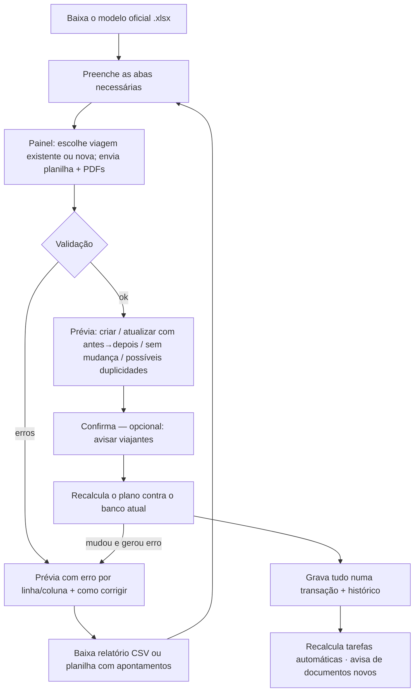
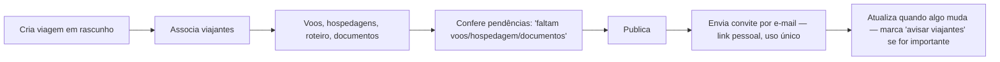
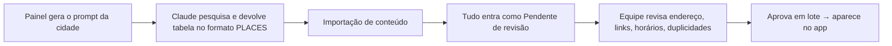
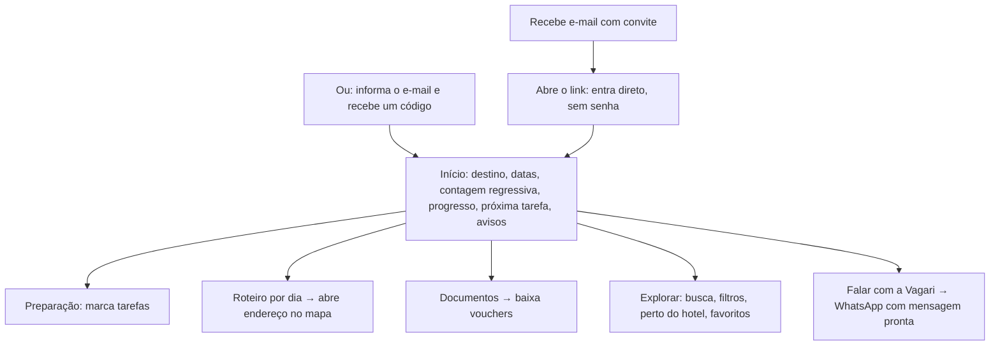

# Vagari Experience — Arquitetura do MVP

Responde aos itens 1 a 3 do §16 do PRD: arquitetura recomendada, esquema do banco com permissões e fluxos principais.

## 1. Arquitetura recomendada

```
 Celular do viajante (PWA)        Navegador da equipe (painel)
            │                                │
            └──────────────┬─────────────────┘
                           │ HTTPS (cookie de sessão httpOnly)
                ┌──────────▼───────────┐
                │  Servidor Node.js    │  Express 5 · uma única aplicação
                │  API + arquivos      │  serve a API, o app e o painel
                │  estáticos (UI)      │
                └───┬──────────┬───────┘
                    │          │
          ┌─────────▼──┐   ┌───▼──────────────────┐
          │  SQLite    │   │  Arquivos privados   │  vouchers, bilhetes, fotos
          │  (1 arquivo)│   │  (disco / S3 depois) │  nunca públicos
          └─────┬──────┘   └──────────────────────┘
                │ backup contínuo (Litestream → armazenamento de objetos)
                ▼
```

| Camada | Escolha | Por quê |
|---|---|---|
| **Backend** | Node.js 22 + Express 5 | Uma linguagem só (JavaScript) do servidor à tela; ecossistema enorme; fácil de achar quem mantenha. Express é simples e estável. |
| **Banco** | SQLite (better-sqlite3) | Zero custo e zero administração; um arquivo. Aguenta com folga a escala do MVP (centenas de viagens, milhares de viajantes). Transações garantem que uma importação grava tudo ou nada. Migrar para PostgreSQL depois é direto (SQL padrão, sem recursos exóticos). |
| **Arquivos** | Disco privado do servidor, atrás de checagem de permissão | Sem custo extra. A interface `put/read/remove` (`server/services/storage.js`) permite trocar por S3/R2/GCS sem mexer no resto. |
| **Autenticação** | Sem senha: link de convite (uso único, expira) ou código de 6 dígitos por e-mail | O viajante não cria conta nem decora senha (PRD §4.1). Não há autocadastro: só entra quem a Vagari associou a uma viagem. A equipe usa o mesmo login por código. |
| **E-mail** | SMTP genérico (Nodemailer) | Funciona com qualquer provedor (Amazon SES, Resend, Brevo, Google Workspace). Sem SMTP, em desenvolvimento o e-mail sai no log. |
| **Planilhas** | ExcelJS (XLSX) + leitor CSV próprio | Lê e gera XLSX (modelo oficial com listas de opções, planilha de apontamentos, exportação da viagem). CSV aceita `;` ou `,`, UTF-8 ou Windows-1252 (o padrão do Excel em português). |
| **App do viajante** | Expo / React Native, publicado na App Store e no Google Play | Decisão da Vagari: app nas lojas passa mais profissionalismo. Um código só para iOS e Android, build e publicação em nuvem (EAS), atualizações rápidas sem nova revisão de loja para mudanças de JavaScript. O mesmo código roda no navegador (usado na prévia). |
| **Painel da equipe** | React + Vite, servido pelo próprio servidor em `/painel` | Web é o melhor formato para trabalho de escritório (tabelas, planilhas, uploads). Mesma identidade e tokens do app (`shared/`). |
| **Hospedagem** | Um contêiner pequeno com disco persistente (ex.: Railway, Render, Fly.io) | Custo baixo (ordem de US$ 5–20/mês), deploy por Git, HTTPS automático. Backup do SQLite com Litestream para um bucket. |

**Sem integrações externas** (companhias aéreas, hotéis, GDS): tudo entra pela equipe, por planilha ou pelo painel (PRD §2 e §12).

### Organização do código

```
server/
  config.js              variáveis de ambiente (só infraestrutura)
  db.js                  esquema e migrações
  domain/entities.js     ★ definição de cada aba/entidade: colunas, tipos, validações, chave estável
  domain/crud.js         gravação unitária do painel (usa as MESMAS regras da importação)
  domain/effects.js      depois de gravar: recalcula tarefas, avisa viajantes
  import/workbook.js     leitura de XLSX/CSV
  import/engine.js       normalizar → verificar → planejar → aplicar (transação)
  import/templates.js    modelo oficial, relatório de erros, planilha com apontamentos, exportação
  services/              auth, settings, storage, checklist (regras), notifications, imports, mailer
  routes/                auth, admin-*, traveler
scripts/                 seed-demo (dados fictícios), build-templates
templates/               modelos oficiais gerados (XLSX e CSV)
test/                    41 testes de ponta a ponta
```

A peça central é `domain/entities.js`: **a mesma definição** valida a importação em lote e os formulários do painel. Um dado nunca é aceito por um caminho e recusado pelo outro.

## 2. Esquema do banco e permissões

### Entidades (PRD §9, com os ajustes justificados abaixo)

| Tabela | Campos principais | Observações |
|---|---|---|
| `users` | id, email (único), name, phone, role (`traveler`/`editor`/`admin`), nationality, preferences, notification_prefs, last_login_at, disabled_at | Viajante criado pela equipe (aba TRAVELERS ou painel). |
| `sessions` | token_hash, user_id, expires_at | Guardamos só o hash do token. 30 dias. |
| `login_codes` | email, code_hash, attempts, expires_at, used_at | 10 min, 5 tentativas, 5 códigos/hora. |
| `invites` | trip_traveler_id, token_hash, expires_at, used_at, revoked_at | Uso único; um novo convite invalida o anterior. |
| `destinations` | **id = destination_id**, parent_id, country, region, city, neighborhood, timezone, overview… | Hierarquia país → região → cidade → bairro via `parent_id`. |
| `trips` | **id = trip_id**, name, destination_id, start/end_date, timezone, status (`draft`/`published`/`archived`/`canceled`), trip_type, cover, notes | Rascunho é invisível ao viajante. |
| `trip_travelers` | trip_id, user_id, traveler_role (`titular`/`acompanhante`/`crianca`), invitation_status | |
| `flight_segments` | trip_id, segment_order (chave), airline, flight_number, aeroportos IATA, departure_at/arrival_at (hora **local** de cada aeroporto) | |
| `accommodations` | external_id (chave), trip_id, city_id, name, checkin/checkout, address, lat/long opcionais | lat/long permitem "perto do hotel". |
| `itinerary_items` | external_id (chave), trip_id, date, start/end_time, city_id, title, category, address, booking_status, confirmation_code | |
| `documents` + `document_versions` | external_id, category, title, stage, storage_key **ou** external_url, sha256, visible_to_traveler, version | Substituir arquivo cria versão nova; as anteriores ficam para a equipe. |
| `checklist_rules` | title, description, days_before, priority, official_url, conditions (JSON), active | Regras da jornada, editáveis no painel. |
| `tasks` + `task_completions` | trip_id, rule_id **ou** external_id, due_date, priority, active | Conclusão **por viajante** (passaporte é pessoal). |
| `places` + `place_media` | **id = content_id**, destination_id, category, descrição ≤ 350, links, horário, tags, source_url, last_verified_at, status (`pending_review`/`approved`/`archived`) | Só `approved` aparece no app. |
| `trip_places` | trip_id, place_id, note | Destaques da Vagari para uma viagem. |
| `favorites` | user_id, place_id | |
| `announcements` | trip_id, title, body, essential | |
| `notifications` | user_id, kind, title, body, link, essential, dedupe_key (único), email_status, read_at | Dedupe evita alerta duplicado. |
| `import_jobs` | kind, arquivos, status (`preview`/`completed`/`failed`/`canceled`), prévia, resumo, contagem de erros | Prévia expira em 24 h. |
| `audit_log` | actor_id, entity_type, entity_id, trip_id, action, before/after (só campos alterados), source (`panel`/`import`/`system`) | Toda alteração administrativa e todo download de documento pela equipe. |
| `settings` | key, value | WhatsApp, textos, categorias, prazos — tudo configurável. |
| `usage_events`, `privacy_requests` | | Métricas do MVP e pedidos LGPD. |

**Ajustes em relação ao PRD §6.1** (todos opcionais para quem preenche):
- Abas sem ID próprio no PRD ganharam uma coluna de ID **opcional**: `accommodation_id`, `item_id`, `document_id`, `task_id`. Sem ela, a chave é natural (ex.: nome do hotel + data de check-in). Com ela, dá para mudar o check-in sem duplicar.
- `TRAVELERS` ganhou `nationality` (opcional) e `TRIPS` ganhou `trip_type` e `language` — necessários para as regras da jornada (PRD §8).
- `ACCOMMODATIONS` ganhou `latitude`/`longitude` opcionais e `ITINERARY` ganhou `confirmation_code`.
- `DESTINATIONS` ganhou `parent_id` (hierarquia) e `PLACES` ganhou `verification_notes` (as "observações de confiança" do prompt do §7.4).
- `DOCUMENTS` ganhou `stage` (antes/ida/destino/volta) para "organizar por etapa" (§4.6).

### Permissões por perfil

| Ação | Viajante | Editor de conteúdo | Administrador |
|---|:-:|:-:|:-:|
| Ver viagens publicadas às quais foi associado | ✅ | – | ✅ (todas, inclusive rascunho, em modo pré-visualização) |
| Ver documentos marcados como visíveis da própria viagem | ✅ | – | ✅ (todos) |
| Marcar tarefas, favoritar, preferências, exportar os próprios dados | ✅ | – | – |
| Editar voos, hotéis, roteiro, datas, documentos | ❌ | ❌ | ✅ |
| Criar viagens, associar viajantes, enviar convites, avisos | ❌ | ❌ | ✅ |
| Importar planilha de **viagem** | ❌ | ❌ | ✅ |
| Destinos, lugares, imagens; importar planilha de **conteúdo**; aprovar/arquivar | ❌ | ✅ | ✅ |
| Configurações, regras da jornada, equipe, histórico, métricas, pedidos LGPD | ❌ | ❌ | ✅ |

Regras que os testes garantem: viajante de outra viagem recebe 404 (não "proibido", para não revelar que existe); trocar o código da viagem na URL não dá acesso a documento alheio; link assinado de documento expira em 5 min e revalida a permissão no download; não é possível remover o último administrador; usuário desativado perde a sessão na hora; requisição de outra origem com cookie é recusada.

## 3. Fluxos principais

### Equipe: importar uma viagem (PRD §6.2)



Regras: IDs estáveis atualizam sem duplicar; nada é apagado por ausência na planilha; célula vazia mantém o valor (escreva `[limpar]` para apagar); registros existentes aceitam planilha parcial (só as colunas que mudaram).

### Equipe: preparar e publicar uma viagem



### Equipe: biblioteca de destinos com o Claude (PRD §7.3)



### Viajante



## Segurança e LGPD (PRD §11)

- Sessão em cookie `httpOnly`, `SameSite=Lax` e `Secure` em produção, mais checagem de origem em toda escrita.
- Só hashes de códigos, convites e sessões no banco. Limite de tentativas no login.
- Arquivos privados, servidos só após checagem de permissão; tipo de arquivo conferido pelo conteúdo (não pela extensão).
- Criptografia em trânsito (HTTPS do provedor) e em repouso (disco/volume criptografado do provedor + bucket de backup criptografado).
- Minimização: o viajante informa só nome/contato e, se quiser, preferências. Nada de passaporte, cartão ou senha de terceiros.
- Titular pode baixar os próprios dados (`/api/me/export`) e abrir pedidos de acesso/correção/exclusão, que aparecem no painel.
- Histórico de alterações com autor, data e antes/depois.

## Decisões em aberto (PRD §17) e o que foi assumido

| Pergunta | Assumido no código (ajustável) |
|---|---|
| Número de WhatsApp e mensagem | Configuração no painel; botão some enquanto não houver número. Mensagem padrão com nome, viagem, código e destino. |
| E-mail com código, link mágico ou senha? | Os dois primeiros: convite (link de uso único) + código por e-mail. Sem senha. |
| Planilha/sistema atual | Modelo próprio + exportação da viagem no mesmo formato. Quando soubermos o sistema atual, dá para aceitar os nomes de coluna dele como apelidos. |
| Campos obrigatórios de voo/hotel/passeio | Os do PRD; ajustáveis em `domain/entities.js`. |
| Primeira carga de destinos | Fluxo pronto (prompt → importação → revisão). Falta a lista de cidades. |
| Atendimento 24h | Desligado por padrão; o texto "24 horas" só aparece se o painel ligar. |
| Quem publica conteúdo e administra viagens | Perfis `admin` e `editor`. Primeiro admin via `ADMIN_EMAILS`. |
